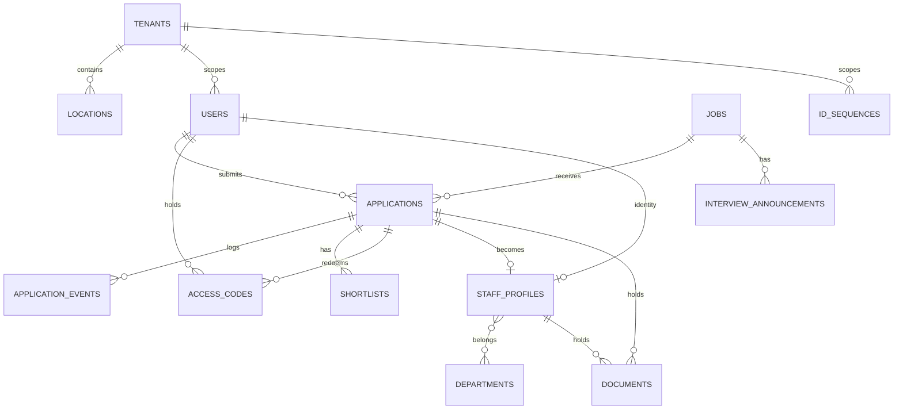

# Mobigate Group Management Portal (MGM-Portal)

**MVP System Requirements Document** · v3.0 · October 2026

---

## Document control

| Field | Value |
|---|---|
| Product | Mobigate Group Management Portal ("MGM-Portal") |
| Document type | MVP system requirements (functional + data + non-functional) |
| Status | Draft for engineering review |
| MVP scope | Recruitment pipeline + staff onboarding: setup → job application → interview & shortlisting → appointment & staff onboarding |
| Supersedes | v2.0 (full-lifecycle scope with Phases 1–3) |
| Deferred | Personnel administration, finance and insurance modules → post-MVP, tracked in §2.2 |

---

## 1. MVP overview

MGM-Portal MVP is a web application that takes a person from **anonymous job applicant** to **verified, identified staff member**, and keeps the record of that transition auditable.

The MVP covers four things end to end:

1. **Setup** — hierarchy of Countries, States, LGAs, Cities, Towns; Admin accounts and their approval.
2. **Recruitment** — public job postings, applications with CV/photo upload, application status tracking.
3. **Interview & shortlisting** — interview announcements, multi-select shortlisting, candidate-facing confirmation messages.
4. **Appointment & onboarding** — access code issuance, code redemption, staff details submission, automatic Staff ID generation, staff login.

The four functional pillars the MVP is judged on:

| Pillar | Success measure |
|---|---|
| **Pipeline integrity** | Every application has a status, a number, and a timestamped history. No application is invisible to Admin. |
| **Verification before access** | Zero staff accounts exist without an admin verification event and a redeemed access code on record. |
| **Traceable communication** | Every message sent to a candidate — receipt, interview, shortlist, access code — is stored verbatim and linked to the applicant. |
| **Instant identity** | A redeemed code yields a Staff ID in the same transaction, with no manual step. |

### 1.1 Design principles

- **Administrator-mediated onboarding.** No person reaches an active staff account without a human verification step.
- **State-scoped administration.** The Group operates across states; each state has its own administration boundary, candidate pool, and ID sequence.
- **Code-based authority.** Possession of an access code is what authorises onboarding. Codes are single-use, time-boxed, revocable, and rate-limited.
- **Everything is auditable.** Status transitions, code issuance, code redemption, CV downloads, and admin account changes are all logged with actor and timestamp.
- **Recruit fast, decide deliberately.** The candidate-facing funnel is minimal; the administrative side carries the weight.

### 1.2 Roles

| Role | Summary |
|---|---|
| **Super Admin** | Owns the single admin dashboard across all states: locations, admin accounts, jobs, applications, interviews, shortlists, access codes, staff onboarding, templates/settings, notifications, and audit. |
| **Admin** | Delegated operator using the same admin dashboard, scoped to their own state. There is no separate admin board. |
| **Applicant (Public User)** | Applies for a job via an online form; checks application/shortlist status; views interview announcements. |
| **Staff (Appointed Applicant)** | Logs in with an access code; submits staff details/profile; receives an auto-generated Staff ID. |

> Note on a fourth role: the v1.0 product overview also described **Director, Employee, Contractor, Partner** as account types. These are *employment categories* (a property of an appointed person), not system roles, and they are not part of the MVP. The `staff_profiles` table carries an `employment_category` column so the data is captured from day one without requiring a separate role system. See §11.2 D7.

---

## 2. Scope

### 2.1 In scope (MVP)

| # | Module | Summary | Source |
|---|---|---|---|
| M1 | Location management | Country → State → LGA → City/Town hierarchy | Admin panel |
| M2 | Accounts, roles, authentication | Super Admin / Admin / Applicant / Staff, approval flow | Super Admin |
| M3 | Job management | Post, edit, close jobs | Admin panel |
| M4 | Public application | Online form, CV + photo upload, application number | Applicant |
| M5 | Application management | View, filter, search, download CV | Admin panel |
| M6 | Interview module | Post announcement, send notification | Admin panel |
| M7 | Shortlist module | Shortlist action + custom confirmation message | Admin panel |
| M8 | Access code management | Generate, issue, revoke codes | Admin panel |
| M9 | Staff onboarding | Redeem code, submit staff details, auto Staff ID | Staff |
| M10 | Staff management | View staff details, generate Staff ID | Admin panel |
| M11 | Dashboard | Total applications, shortlisted, staff | Admin panel |
| M12 | Notifications | SMS / email for shortlist and access code | Key functions |
| M13 | Settings | Confirmation messages, email templates | Admin panel |

### 2.2 Deferred (post-MVP, not in this build)

Retained here so the data model does not block them, but explicitly **out of MVP scope**:

- Personnel record set: attendance/clock-in, loans, IOU, contributions, welfare, stakeholdings, appraisals, awards, suspensions, penalties, transfers, promotions, queries, recommendations, rules of engagement, job/vacation/overtime schedules, teams, asset custody
- Financial records: salary, overtime and allowance payment records
- Insurance records: life, comprehensive, health, risk
- Messaging & collaboration: internal chat, team discussions, virtual meetings, media sharing
- Formal requests: resignation, permission requests, memos, letters, with routing
- Privacy controls and profile-visibility settings
- Personal self-service dashboard

---

## 3. Roles and permissions

### 3.1 Permission matrix

| Capability | Super Admin | Admin | Applicant | Staff |
|---|:--:|:--:|:--:|:--:|
| Create / manage States | ✅ | — | — | — |
| Create Admin accounts | ✅ | — | — | — |
| Approve Admin accounts | ✅ | — | — | — |
| Approve locations | ✅ | ✅ (propose) | — | — |
| Manage location hierarchy | ✅ | ✅ | — | — |
| Post / edit / close jobs | ✅ | ✅ (own state) | — | — |
| View all applications (all states) | ✅ | — | — | — |
| View applications (own state) | ✅ | ✅ | — | — |
| Filter by State / LGA / Job | ✅ | ✅ | — | — |
| Search applications | ✅ | ✅ | — | — |
| Download CV | ✅ | ✅ | — | — |
| Post interview announcements | ✅ | ✅ (own state) | — | — |
| Send interview notification | ✅ | ✅ (own state) | — | — |
| View interview announcements | — | — | ✅ | ✅ |
| Shortlist candidates | ✅ | ✅ (own state) | — | — |
| Add shortlist confirmation message | ✅ | ✅ (own state) | — | — |
| Issue access code | ✅ | ✅ (own state) | — | — |
| Revoke access code | ✅ | ✅ (own state) | — | — |
| Approve staff | ✅ | ✅ (own state) | — | — |
| Generate Staff ID | ✅ | ✅ (own state) | — | — |
| View staff details | ✅ | ✅ (own state) | — | — |
| Redeem access code / submit staff details | — | — | — | ✅ |
| View own application & shortlist status | — | — | ✅ | — |
| Edit confirmation messages & email templates | ✅ | ✅ (own state) | — | — |
| View audit log | ✅ | ✅ (own state) | — | — |

Both admin roles use the **same `/admin` dashboard**. The Super Admin sees every state and owns the full capability set; a delegated Admin sees the same screens limited to their own state. There is no second admin board.

### 3.2 Account lifecycle

```
super_admin:  created ──▶ active
admin:        created ──▶ pending ──▶ active ──▶ suspended
              (invite sets password; Super Admin approves before it can act)
applicant:    registered ──▶ active
staff:        (none) ──▶ redeemed ──▶ active
              code redeemed → staff profile submitted → Staff ID issued
```

---

## 4. Full workflow

### 4.1 Step 1 — Setup

**Actor: Super Admin**

1. Super Admin creates the location hierarchy: **Country → State → LGA → City/Town**.
   - LGA (Local Government Area) is the administrative subdivision of a state. Cities and towns sit *inside* an LGA, so the tree is `country → state → lga → city|town`.
   - The v1.0 draft listed the order as `Country → State → City → Town → Local Government`, which places LGA below town. That is not how Nigerian administrative geography works, so the tree is implemented as above. The data model is a generic parent/child tree (§9.2), so if the business later wants a different traversal order it is a configuration change, not a schema change.
2. If the Super Admin wants to delegate, they create Admin accounts and assign each a state scope. Delegated Admins use the same dashboard, limited to that state.
3. Admin sets a password from the invite and activates the account.
4. Super Admin approves the account. Until approved, the Admin can sign in but can perform no action.

### 4.2 Step 2 — Job application

**Actors: Admin, Applicant**

1. Admin posts a job vacancy: title, description, requirements, location, openings, deadline, status.
2. Job becomes visible on the public careers page and the application form.
3. Applicant registers (email, phone, password) or signs in, then fills the application form:

   | Field | Notes |
   |---|---|
   | Full name | Split into first/last for sorting; full name retained for display |
   | Email | Primary contact; used for all notifications |
   | Phone | Primary SMS/WhatsApp contact |
   | Gender | Select |
   | Date of birth | Date picker |
   | Country | Select, cascading |
   | State | Select, filtered by country |
   | LGA | Select, filtered by state |
   | City | Select, filtered by LGA |
   | Town | Optional text/select, filtered by LGA |
   | Qualification | Text (highest qualification) |
   | CV upload | PDF/DOC/DOCX, size-capped |
   | Position applied for | Select from published jobs |
   | Photo | JPG/PNG/WEBP, size-capped |

4. On submission the system generates an **Application Number** and displays it to the applicant with an "Application Received" confirmation.
5. The application enters `pending`. The applicant can check status at any time from their portal.

### 4.3 Step 3 — Interview and shortlisting

**Actors: Admin, Applicant**

1. Admin opens the portal and sees the applications list — filterable by **State, LGA, Job**, searchable by name, email, and application number. CVs are downloadable.
2. Admin posts an **Interview Announcement** for a job: **date, venue, time, instructions**.
   - The announcement is published to applicants **of that job** and to shortlisted candidates. Publishing one job's interview details to applicants of every other job leaks process information across the pipeline, so the audience is scoped by default; an `all_applicants` audience is available as an explicit Admin override.
3. After the interview, Admin selects one or more applications (checkbox / multi-select) and chooses **Shortlist**.
4. Admin writes a **Confirmation Message** in the message box — free text or a saved template, e.g. *"Congratulations, you have been shortlisted for [Job]. Please report to [Venue] on [Date] with [Documents]."*
5. The message is stored verbatim against the shortlist record and delivered to those candidates. It is visible to **only** the shortlisted candidates when they check their status.

### 4.4 Step 4 — Appointment and staff onboarding

**Actors: Admin, Staff**

1. Admin approves the shortlisted candidate for appointment, records the employment category, and the system **generates an access code**.
2. Admin issues the code. It is shown on the portal for the Admin to copy/send, and delivered to the candidate by **email and SMS/WhatsApp** as configured.
3. Candidate opens the Staff Portal, signs in, and enters the access code.
4. System validates the code: exists, status `active`, not expired, not already used, tenant matches, below the failed-attempt threshold.
5. Candidate submits the **staff details form**:
   - Bio-data (name, gender, date of birth, phone, email, address)
   - Bank details (bank name, account name, account number)
   - Guarantor (name, relationship, phone, address)
   - Next of kin (name, relationship, phone)
   - Supporting documents (ID, qualification certificates, others)
   - Employment details (department, position, appointment date, employment category)
6. On submit the system, **in one transaction**:
   - creates the staff profile,
   - generates the **Staff ID** in the form `STA/{STATE_CODE}/{YEAR}/{0001}`, incrementing the tenant's sequence for that year,
   - marks the access code `used`,
   - records the audit event.
7. The Staff can now log in with **Staff ID + Access Code**, and their Staff ID is displayed in their portal.

### 4.5 Application status state machine

```
                     ┌──────────────┐
   submit ─────────▶│  pending     │
                     └──┬───┬───┬──┘
              shortlist │   │   │ withdraw
                        ▼   │   └──────────▶ withdrawn
                 ┌──────────────┐
                 │ shortlisted  │
                 └────┬─────┬───┘
             appoint │     │ reject
                      ▼     └──────────▶ rejected
              ┌──────────────┐
              │  appointed   │──▶ access code issued ──▶ staff profile created
              └──────────────┘
```

Transitions are one-way and recorded in `application_events` with actor, from-state, to-state, reason, and timestamp.

### 4.6 Access code state machine

```
   issued ──▶ active ──┬──▶ used      (redeemed by candidate)
                        ├──▶ revoked   (admin action)
                        └──▶ expired   (TTL elapsed)
```

---

## 5. Module specifications

### M1 — Location management

- Hierarchical tree with types `country`, `state`, `lga`, `city`, `town`.
- Enforced parentage: `state` → `country`; `lga` → `state`; `city`/`town` → `lga`.
- Cascading selects on the public application form derive from this tree.
- Soft delete. A location referenced by an active job, application, or staff record cannot be deleted.
- Admin maintains locations; Super Admin approves additions. New locations created by an Admin enter `pending` and require Super Admin approval before they appear in the public form.
- Locations are tenant-scoped below `state`.

### M2 — Accounts, roles, authentication

- Email + password for Admin, Staff and Applicant.
- Passwords hashed with a memory-hard algorithm (Argon2id or bcrypt, cost ≥ 12). No plaintext, no reversible encoding.
- Password reset via emailed single-use token.
- Sessions: httpOnly, SameSite=Lax cookies, idle timeout, forced logout on password change.
- Account states: `pending` (Admin awaiting approval) → `active` → `suspended` / `disabled`.
- Optional TOTP MFA for Super Admin and Admin — recommended before the platform holds real personnel data.

### M3 — Job management

- CRUD: title, slug, description, requirements, location, employment category, openings, publish date, deadline, status (`draft`, `published`, `closed`, `archived`).
- Deadline enforced on the public form — no applications accepted after it.
- Public careers page lists only `published` jobs.
- Applicants cannot apply to a closed or unpublished job.
- A job with active applications cannot be deleted; it must be closed, then archived.

### M4 — Public application

- Form as specified in §4.2, validated server-side.
- File upload: CV (PDF, DOC, DOCX) and photo (JPG, PNG, WEBP). Size-capped, MIME validated against sniffed content type, stored outside the web root, served through an authorized route.
- Duplicate prevention: one application per email per open job. Re-applying to a *different* job is allowed. A rejected applicant may re-apply to the same job, which creates a new application linked to the prior one.
- Applicant may view and edit a `pending` application. A `shortlisted` or later application is locked for applicant editing.
- Application Numbers are sequential per tenant per year: `APP/{STATE_CODE}/{YEAR}/{0001}`.

### M5 — Application management

- List with server-side pagination, filtering (state, LGA, job, status, date range) and text search (name, email, application number).
- Sortable by submitted date, status, job.
- CV download gated behind Admin permission; the download itself is logged.
- Bulk actions: shortlist, reject, appoint.
- Applicant PII is visible only to Admin/Super Admin, and reads are logged.

### M6 — Interview module

- CRUD per job: date, venue, time, instructions.
- Publish/unpublish state; `cancelled` state for a withdrawn interview.
- Notification dispatched on publish to the scoped audience (§4.3).
- Applicant-facing list shows only announcements the applicant is entitled to see.

### M7 — Shortlist module

- Multi-select applications → single shortlist action.
- A custom confirmation message is **mandatory** — the shortlist action cannot be submitted without one. Composed freehand or from a saved template with placeholders.
- Message stored verbatim on the shortlist record; the delivered copy is recorded.
- Shortlist can be revoked by Admin; revocation notifies the candidate and returns the application to `pending`.
- Only shortlisted applicants see the confirmation message when checking status.

### M8 — Access code management

- Admin screen listing all codes with filters: status, type, issue date, expiry, associated application.
- Generate a code for an applicant or staff; issue it to a shortlisted/appointed candidate; revoke an active code.
- Code format: **6-character alphanumeric** (per MVP spec), generated from an unambiguous alphabet, rendered uppercase, and formatted for legibility when copied to SMS — e.g. `K7M2Q9`. Entry is case-insensitive and whitespace-tolerant.
  - Note: 6 characters from a 32-symbol base32 alphabet is ~30 bits of entropy, which is adequate *only* because redemption is rate-limited, attempt-locked, and time-boxed. If codes ever become long-lived, raise the length (see §11.2 D1).
- Codes are stored **hashed**. To resend a code, the Admin revokes and regenerates rather than retrieving the original (see §11.2 D1).
- Configurable TTL (default 14 days), extendable, revocable at any time.
- Redemption attempts rate-limited per code and per IP; 5 failed attempts locks the code and requires reissue.

### M9 — Staff onboarding

- Redemption validates the code, then opens the staff details form.
- Form sections as specified in §4.4, validated server-side.
- Bank account number validated against the account name where the bank is supported.
- Documents stored against the staff record with a type label.
- Profile may be saved as a draft and resumed across sessions.
- On submit: staff profile creation, Staff ID generation, code consumption, and audit entry happen atomically. A failure in any one rolls back all four.

### M10 — Staff management

- Searchable, filterable list of staff by state, department, employment category, position, and status.
- Staff record view: bio-data, employment details, bank details, guarantor, documents, and the access-code history.
- Bank details and guarantor are visible to the record owner, Admin and Super Admin only — never to peers, and not included in list or export views.

### M11 — Dashboard

The single admin dashboard, owned by the Super Admin and covering all states. Delegated Admins use the same dashboard, filtered to their own state:

| Tile | Metric |
|---|---|
| Total applications | Count, with a delta vs. the previous period |
| Pending | Count, linked to a filtered list |
| Shortlisted | Count, linked to a filtered list |
| Rejected | Count |
| Appointed | Count |
| Staff | Total active staff, linked to the staff directory |
| Active access codes | Count of issued-but-unredeemed codes |
| Interviews upcoming | Count of published interviews with a future date |
| Expiring codes | Count of active codes expiring within 7 days |

Each tile links to the corresponding filtered list. Charts are limited to a single recent-activity panel (applications per day for the last 30 days) to keep the page fast and the metric count low.

### M12 — Notifications

| Event | Channels | Recipient |
|---|---|---|
| Application received | Email (SMS optional) | Applicant |
| Interview announcement published | Email, SMS, WhatsApp | Applicants of that job (or scoped audience) |
| Shortlisted | Email, SMS, WhatsApp | Shortlisted candidate |
| Not shortlisted | Email | Rejected applicant |
| Access code issued | Email, SMS, WhatsApp | Appointed candidate |
| Staff profile created | Email | Staff member, Admin |

- Provider abstraction with pluggable backends, so a provider outage or switch is a config change rather than a code change.
- Every notification is persisted with payload, channel, provider reference, status and error, so failures are visible and retryable.
- Retry with backoff; a permanently failed delivery raises a visible alert to Admin.

### M13 — Settings

- **Confirmation messages** — reusable shortlist confirmation templates with placeholder substitution (e.g. `{{job_title}}`, `{{venue}}`, `{{date}}`, `{{applicant_name}}`).
- **Email templates** — templates for application receipt, interview announcement, shortlist, rejection, access code, and staff creation.
- **Access code settings** — code length, TTL, failed-attempt threshold.
- **Users** — list, suspend, reinstate, force password reset.
- **Admin accounts** — create, approve, suspend, reset.
- **Audit log** — actor, action, entity, entity ID, before/after snapshot, IP, user agent, timestamp. Filterable, exportable, append-only.

---

## 6. Admin panel screens

All screens below belong to one `/admin` dashboard. The Super Admin sees the full set across all states; delegated Admins see the same screens scoped to their state.

| # | Screen | Contents | Primary actions |
|---|---|---|---|
| 1 | **Dashboard** | §M11 tiles + recent activity panel | Navigate to filtered lists |
| 2 | **Location Management** | Tree browser, add/edit, approval queue | Add, edit, approve, deactivate |
| 3 | **Access Code Management** | Code list with filters, code detail, issue dialog | Generate, issue, revoke, regenerate |
| 4 | **Job Management** | Job list, job editor | Post, edit, publish, close, archive |
| 5 | **Application Management** | Filterable/sortable list, detail drawer | Search, filter, download CV, shortlist, reject, appoint |
| 6 | **Interview Module** | Announcements per job, editor, notification log | Post, publish, notify, cancel |
| 7 | **Shortlist Module** | Shortlist queue, bulk-select, confirmation message box | Shortlist (message required), revoke, resend message |
| 8 | **Staff Management** | Staff list, staff record view, Staff ID | View, generate/regenerate ID, suspend |
| 9 | **Settings** | Confirmation messages, email templates, code settings, users, admins, audit log | Edit, approve, export |

**Applicant portal:** account registration/login, careers page, application form, my applications (with status, application number, shortlist confirmation message where applicable), interview announcements.

**Staff portal:** login with Staff ID + access code, staff details form, my profile (Staff ID, appointment, bank, guarantor, documents).

---

## 7. Key functions

| # | Function | Specification |
|---|---|---|
| K1 | **Auto-generate access code** | 6-character alphanumeric from a 32-symbol Crockford base32 alphabet (excludes `I`, `L`, `O`, `U` to avoid misreading), rendered uppercase. Stored hashed. Unique under retry on collision. Expiry stamped on issue. |
| K2 | **Auto-generate Staff ID** | `STA/{STATE_CODE}/{YEAR}/{0001}` — zero-padded to 4 digits, sequence per tenant per year, allocated atomically (§BR-03). Issued once, at profile creation, never reused. |
| K3 | **SMS / email notification** | Triggered on shortlist and on access code issue, plus the additional events in §M12. Queued, retried with backoff, persisted, and surfaced to Admin on permanent failure. |
| K4 | **Search & filter** | By State, LGA and Job across the applications list, and by name, email and application number as free text. Server-side, indexed, paginated. |

---

## 8. Personnel record (MVP subset)

Only what the MVP captures. Each field group is a set of columns on `staff_profiles` (not a JSON blob — see §9.4) so that values remain queryable, validatable, and individually access-controlled.

| Group | Fields |
|---|---|
| Identity | First name, last name, gender, date of birth, photo, phone, email, address, location (country/state/LGA/city/town) |
| Employment | Staff ID, employment category, department, position, appointment date, rules-of-engagement acknowledgement (timestamp, post-MVP text) |
| Banking | Bank name, account name, account number |
| Guarantor | Name, relationship, phone, address |
| Next of kin | Name, relationship, phone |
| Documents | ID, qualification certificates, others — typed, with file metadata |
| Audit | Created at, updated at, source application, redeeming admin |

---

## 9. Data model

The MVP sketch suggested seven tables: `users`, `locations`, `jobs`, `applications`, `interview_announcements`, `access_codes`, `staff_profiles`. Those seven are kept, with the same names and the same responsibilities. The adjustments are:

- `locations` becomes a **parent/child tree** instead of one row carrying `country, state, city, town, lga` columns — a flat version duplicates the hierarchy and cannot express that a state has many LGAs.
- `staff_profiles` gets **structured columns** instead of `details_json` — a JSON blob discards the validation and per-field access control the spec requires (bank details visible to owner/admin only, not peers).
- `access_codes` gets `code_hash` + `code_hint` instead of a plaintext `code` column, plus expiry and attempt tracking.
- Supporting tables are added: `documents`, `notifications`, `message_templates`, `application_events`, `audit_logs`, `id_sequences`, `sessions`.

### 9.1 `tenants` — state scoping

```sql
tenants (
  id                uuid primary key,
  name              text not null,
  state_location_id uuid references locations(id),
  status            text not null default 'active',   -- active | suspended
  created_at        timestamptz not null default now()
)
```

### 9.2 `locations`

```sql
locations (
  id          uuid primary key,
  tenant_id   uuid references tenants(id),   -- null for country-level rows
  parent_id   uuid references locations(id),
  type        text not null,                -- country | state | lga | city | town
  name        text not null,
  code        text,                         -- short uppercase code, used in ID sequences
  slug        text not null unique,
  status      text not null default 'approved',  -- pending | approved | inactive
  created_at  timestamptz not null default now()
)
```

### 9.3 Recruitment

```sql
users (
  id                uuid primary key,
  tenant_id         uuid references tenants(id),
  role              text not null,          -- super_admin | admin | staff | applicant
  email             citext not null unique,
  phone             text,
  password_hash     text,
  first_name        text not null,
  last_name         text not null,
  status            text not null default 'active',  -- pending | active | suspended | disabled
  email_verified_at timestamptz,
  phone_verified_at timestamptz,
  last_login_at     timestamptz,
  created_at        timestamptz not null default now(),
  updated_at        timestamptz not null default now()
)

jobs (
  id                  uuid primary key,
  tenant_id           uuid not null references tenants(id),
  title               text not null,
  slug                text not null,
  description         text not null,
  requirements        text,
  location_id         uuid references locations(id),
  employment_category text,                -- director | employee | contractor | partner
  openings            integer not null default 1,
  publish_at          timestamptz,
  deadline_at         timestamptz,
  status              text not null default 'draft',  -- draft | published | closed | archived
  created_by          uuid references users(id),
  created_at          timestamptz not null default now()
)

applications (
  id                 uuid primary key,
  application_number text not null unique,   -- APP/LA/2026/0001
  tenant_id          uuid not null references tenants(id),
  job_id             uuid not null references jobs(id),
  applicant_id       uuid not null references users(id),
  first_name         text not null,
  last_name          text not null,
  email              citext not null,
  phone              text not null,
  gender             text,
  date_of_birth      date,
  location_id        uuid references locations(id),
  address_line       text,
  qualification      text,
  cv_document_id     uuid references documents(id),
  photo_document_id  uuid references documents(id),
  status             text not null default 'pending',
  submitted_at       timestamptz not null default now(),
  updated_at         timestamptz not null default now()
)

application_events (
  id             uuid primary key,
  application_id uuid not null references applications(id),
  actor_id       uuid references users(id),
  from_status    text,
  to_status      text not null,
  reason         text,
  created_at     timestamptz not null default now()
)

interview_announcements (
  id           uuid primary key,
  tenant_id    uuid not null references tenants(id),
  job_id       uuid not null references jobs(id),
  interview_at timestamptz not null,
  venue        text not null,
  instructions text,
  audience     text not null default 'job_applicants',  -- job_applicants | shortlisted_only | all_applicants
  status       text not null default 'draft',            -- draft | published | cancelled
  created_by   uuid references users(id),
  created_at   timestamptz not null default now()
)

shortlists (
  id                  uuid primary key,
  application_id      uuid not null references applications(id),
  job_id              uuid not null references jobs(id),
  message             text not null,          -- verbatim confirmation message
  message_template_id uuid references message_templates(id),
  status              text not null default 'active',   -- active | revoked
  created_by          uuid references users(id),
  created_at          timestamptz not null default now(),
  revoked_at          timestamptz
)
```

### 9.4 `access_codes` and `staff_profiles`

```sql
access_codes (
  id              uuid primary key,
  tenant_id       uuid not null references tenants(id),
  code_hash       text not null unique,     -- never store the plaintext
  code_hint       text not null,            -- last 4 chars, for support lookups
  type            text not null,            -- applicant | staff
  application_id  uuid references applications(id),
  issued_to       uuid references users(id),
  issued_by       uuid references users(id),
  status          text not null default 'active',  -- active | used | revoked | expired
  expires_at      timestamptz not null,
  used_at         timestamptz,
  used_by         uuid references users(id),
  failed_attempts integer not null default 0,
  created_at      timestamptz not null default now()
)

staff_profiles (
  id                uuid primary key,
  tenant_id         uuid not null references tenants(id),
  user_id           uuid references users(id),
  staff_id          text unique,            -- STA/LA/2026/0001
  application_id    uuid references applications(id),
  employment_category text not null,        -- director | employee | contractor | partner
  first_name        text not null,
  last_name         text not null,
  email             citext not null,
  phone             text not null,
  gender            text,
  date_of_birth     date,
  address_line      text,
  location_id       uuid references locations(id),
  bank_name         text,
  bank_account_name text,
  bank_account_number text,
  guarantor_name       text,
  guarantor_phone      text,
  guarantor_address    text,
  guarantor_relationship text,
  next_of_kin_name        text,
  next_of_kin_phone       text,
  next_of_kin_relationship text,
  department_id       uuid references departments(id),
  position           text,
  appointment_date   date,
  rules_of_engagement_accepted_at timestamptz,
  status             text not null default 'active',  -- active | suspended | exited
  created_at         timestamptz not null default now(),
  updated_at         timestamptz not null default now()
)

departments (
  id        uuid primary key,
  tenant_id uuid not null references tenants(id),
  name      text not null
)
```

### 9.5 Supporting tables

```sql
documents (
  id          uuid primary key,
  tenant_id   uuid references tenants(id),
  owner_type  text not null,     -- application | staff
  owner_id    uuid not null,
  category    text not null,     -- cv | photo | appointment_letter | id_proof | qualification | other
  file_name   text not null,
  storage_key text not null,
  mime_type   text not null,
  size_bytes  integer not null,
  uploaded_by uuid references users(id),
  created_at  timestamptz not null default now()
)

message_templates (
  id         uuid primary key,
  tenant_id  uuid references tenants(id),
  key        text not null,       -- shortlist_confirmation | application_received | access_code_issued | interview_announcement
  channel    text not null,       -- email | sms | whatsapp
  subject    text,
  body       text not null,
  variables  jsonb not null default '{}',
  created_at timestamptz not null default now(),
  unique (tenant_id, key, channel)
)

notifications (
  id                uuid primary key,
  tenant_id         uuid references tenants(id),
  recipient_user_id uuid references users(id),
  recipient_contact text,
  channel           text not null,
  template_key      text,
  payload           jsonb not null,
  provider_ref      text,
  status            text not null default 'pending',  -- pending | sent | failed | read
  error             text,
  sent_at           timestamptz,
  created_at        timestamptz not null default now()
)

id_sequences (
  id         uuid primary key,
  scope      text not null,      -- applications | staff
  tenant_id  uuid not null references tenants(id),
  year       integer not null,
  prefix     text not null,      -- APP | STA
  state_code text not null,
  last_value integer not null default 0,
  unique (scope, tenant_id, year)
)

audit_logs (
  id          uuid primary key,
  tenant_id   uuid references tenants(id),
  actor_id    uuid references users(id),
  action      text not null,
  entity_type text not null,
  entity_id   uuid,
  before_data jsonb,
  after_data  jsonb,
  ip_address  inet,
  user_agent  text,
  created_at  timestamptz not null default now()
)

sessions (
  id         uuid primary key,
  user_id    uuid not null references users(id),
  token_hash text not null unique,
  ip_address inet,
  user_agent text,
  expires_at timestamptz not null,
  revoked_at timestamptz,
  created_at timestamptz not null default now()
)
```

### 9.6 Entity relationships



---

## 10. Business rules

| ID | Rule |
|---|---|
| BR-01 | Application Numbers are sequential per tenant per year: `APP/{STATE_CODE}/{YEAR}/{0001}`, zero-padded to 4 digits. |
| BR-02 | Staff IDs are sequential per tenant per year: `STA/{STATE_CODE}/{YEAR}/{0001}`. Assigned once at profile creation and never reused, even if the person exits. |
| BR-03 | Sequence values are allocated with an atomic increment (row lock or `INSERT … ON CONFLICT … DO UPDATE … RETURNING`) so concurrent applications cannot collide. |
| BR-04 | Access codes are 6 characters from a 32-symbol Crockford base32 alphabet, rendered uppercase. Entry is case-insensitive and whitespace-tolerant. |
| BR-05 | Access codes expire after a configurable TTL (default 14 days) and are single-use. |
| BR-06 | Five failed redemption attempts on a code locks it; the Admin must reissue. |
| BR-07 | A shortlist requires a non-empty confirmation message. The action cannot be completed without one. |
| BR-08 | The shortlist confirmation message is visible only to shortlisted applicants, never to pending or rejected ones. |
| BR-09 | An email may hold at most one open application per job. A rejected applicant may re-apply to the same job, which creates a new application linked to the prior one. |
| BR-10 | An application is locked for applicant editing once it reaches `shortlisted`. |
| BR-11 | Staff profile creation, Staff ID allocation, code consumption, and the audit entry happen in one transaction. Failure of any one rolls back all four. |
| BR-12 | A job with active applications cannot be deleted; it must be closed and then archived. |
| BR-13 | A location referenced by an active job, application, or staff record cannot be deleted. |
| BR-14 | Every status transition, code issuance, code redemption, CV download, and admin account change is written to `audit_logs`. |
| BR-15 | All state mutations are tenant-scoped; a cross-tenant read or write returns 404, not 403, to avoid leaking record existence. |
| BR-16 | Notifications are queued, retried with exponential backoff, and permanently failed deliveries surface to Admin. |
| BR-17 | Passwords are never logged, and access codes never appear in plaintext in logs, notification payloads, or URLs. |
| BR-18 | Only Super Admin can create or approve Admin accounts, and only Super Admin can create States. |

---

## 11. Open decisions

### 11.1 To be confirmed before build

| # | Decision | Recommendation | Impact |
|---|---|---|---|
| D1 | **Access code storage** — plaintext (resendable) vs hashed (must revoke + regenerate to resend) | **Hash it.** Resend = revoke + regenerate, with the candidate notified. A plaintext code in the database is a standing credential leak. | Admin re-issues codes occasionally |
| D2 | **Code length** — 6 characters per MVP spec | **Keep 6**, given rate limiting, attempt lockout, and a 14-day TTL. Raise to 8 if codes ever become long-lived. | Low |
| D3 | **Staff login** — Staff ID + access code only, per MVP spec | **As specified.** The access code is a bearer credential; compensate with rate limiting, attempt lockout, forced code rotation on use, and audit logging. If a password is later wanted, add it without changing the schema. | Security posture |
| D4 | **Applicant account** — register before applying? | **Yes**, email + phone + password at application time. Required for status tracking and for the "only shortlisted see the message" rule. | Slight top-of-funnel friction |
| D5 | **SMS / WhatsApp provider** | Confirm a Nigerian provider (Termii, Arkesel, Greentel) and WhatsApp Business Cloud API template approval status. | Notification delivery; WhatsApp template approval has lead time |
| D6 | **Currency and locale** | Confirm NGN and Nigerian date/name formatting. | Display only in MVP |
| D7 | **Director as category vs role** | Treat directors as staff with a privileged employment category, not a separate system role. | Permissions |
| D8 | **Multi-state at launch** | One state or several? The tenant model supports both; seed data and UI copy differ. | Seed data |
| D9 | **Document retention** | Retention period for CVs and applicant PII, and deletion on rejection. | NDPA alignment |
| D10 | **MFA** | Enable TOTP for Super Admin and Admin before live data. | Security posture |

### 11.2 Suggested stack

The repository contains only this document, so the stack is a proposal.

| Layer | Choice | Rationale |
|---|---|---|
| Framework | Next.js (App Router) + TypeScript | Server actions and API routes in one app; SSR for the public careers page; strong typing across the domain model |
| UI | Tailwind CSS + shadcn/ui | Fast to build the admin tables, forms, and multi-select; accessible primitives |
| ORM | Prisma | Typed schema as the single source of truth; migrations tracked in git |
| Database | PostgreSQL 15+ | Relational integrity, `jsonb` where genuinely open-ended, row-level locking for ID sequences |
| Auth | Custom session auth (httpOnly cookie + `sessions` table) | Full control over the pending-approval and redemption flows, which are core to this system |
| File storage | S3-compatible object storage (AWS S3 / Cloudflare R2) | Durable, cheap, off-web-root; served through an authorization gate |
| Queue | Redis + BullMQ, or pg-boss / SQS | Notification delivery, CV processing, email |
| Email | Resend or Postmark | Transactional delivery with deliverability tooling |
| SMS / WhatsApp | Termii/Arkesel + WhatsApp Business Cloud API | Nigerian market fit; both behind a provider interface |
| Deployment | Vercel (app) + managed Postgres (Neon/Supabase/RDS) | Low ops; environment parity between staging and production |

### 11.3 Non-functional requirements

**Security**
- bcrypt/Argon2id password hashing; optional mandatory MFA for admin tiers.
- Rate limiting on login, code redemption, password reset, and application submission.
- CSRF protection on all state-changing requests; strict CSP.
- File uploads validated by content sniffing, size-capped, stored in a non-public bucket, served through an authorization gate.
- All PII reads of applicant and staff records logged.
- Encryption in transit and at rest; secrets in a managed secret store, never in the repo.

**Performance**
- Public careers page LCP < 2.5s; admin list queries p95 < 500ms.
- Server-side pagination and filtering on all list endpoints; no unbounded result sets.
- Caching for public job listings and location lookups.

**Reliability**
- 99.5% availability target for the MVP.
- Daily full snapshot, point-in-time recovery, quarterly restore test.
- Notification delivery must not block the request that triggered it.

**Compliance**
- Nigeria Data Protection Act alignment: purpose limitation, explicit notice on application, consent capture, subject access, and erasure on rejection once retention elapses.
- Staff PII restricted to Super Admin, the state Admin, and the record owner.

**Usability and accessibility**
- WCAG 2.1 AA target for the public careers flow, the application form, and the staff onboarding form.
- Fully responsive — the applicant and staff flows must work on a phone, since most applicants will apply from one.
- Plain-language confirmations. The shortlist message is read by an applicant at a moment of high emotion; it must be unambiguous.

**Observability**
- Structured logging with request IDs, error tracking, uptime checks, and alerting on notification failure rate.

---

## 12. Build order

Dependency-ordered, so each step is independently testable.

| Step | Deliverable | Depends on |
|---|---|---|
| 1 | Project scaffold, Prisma schema, migrations, tenancy guard, audit log | — |
| 2 | Auth, roles, Admin account creation + approval flow | 1 |
| 3 | Location management: tree, CRUD, approval, cascading selects | 1, 2 |
| 4 | Job management + public careers page | 3 |
| 5 | Application form, CV/photo upload, Application Number generation | 4 |
| 6 | Applicant portal: my applications, status, application number | 5 |
| 7 | Application management: list, filter, search, CV download | 5, 2 |
| 8 | Notification service + templates (email, SMS, WhatsApp adapters) | 1 |
| 9 | Interview module: announcements, publish, notify | 7, 8 |
| 10 | Shortlist module: multi-select, confirmation message, delivery | 7, 8 |
| 11 | Access code management: generate, issue, revoke, expiry | 2, 8 |
| 12 | Staff redemption + staff details form + Staff ID generation | 11, 5 |
| 13 | Staff management + dashboard tiles | 12, 7 |
| 14 | Settings, audit log UI, export | 13 |

**MVP exit criteria:** an applicant applies, is shortlisted with a confirmation message, is appointed, receives an access code, redeems it, submits staff details, and appears in the staff directory with a Staff ID — end to end in staging. Then: the Admin revokes a code, it fails to redeem; a rejected applicant does not see the shortlist message; two concurrent applications do not collide on an Application Number.

---

## 13. Summary

MGM-Portal MVP takes a person from anonymous job applicant to verified, identified staff member, and keeps that transition auditable end to end. The admin panel carries the operational weight — locations, jobs, applications, interviews, shortlists, codes, staff, settings — while the candidate-facing surface stays deliberately minimal: apply, check status, get told clearly what happens next. The Staff ID is the durable output; everything before it exists to make that one moment trustworthy.
